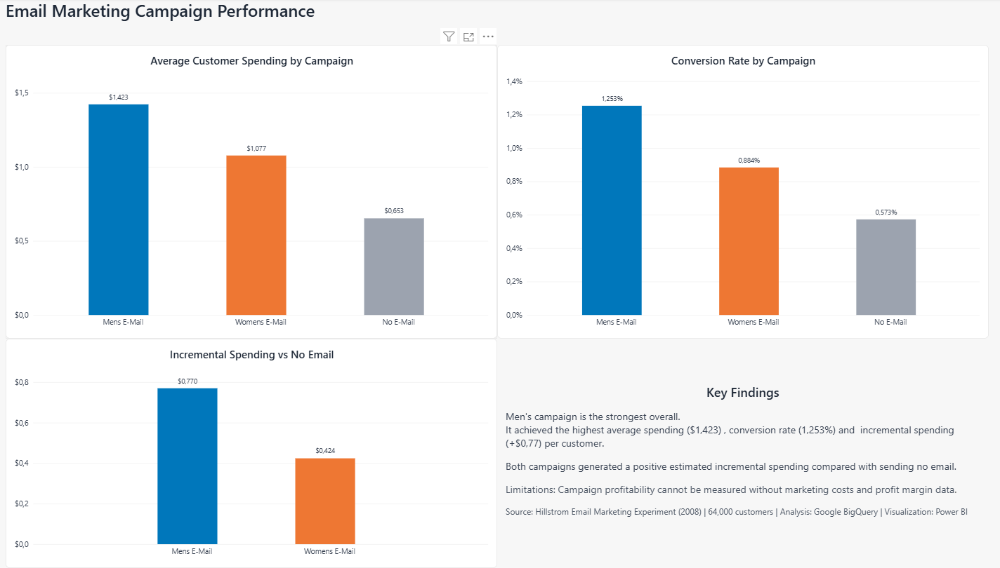

# Email Marketing Campaign Performance Analysis

**SQL (Google BigQuery) | Power BI | Marketing Analytics**

## Project overview

This is my first data analytics portfolio project. I analyzed a randomized email marketing experiment to answer a practical business question:

> **Do promotional emails increase customer spending, and which of the two campaigns performs better?**

The experiment assigned **64,000 customers** to one of three groups: **Men's Email**, **Women's Email**, or **No Email** (the control group). I used SQL in Google BigQuery to compare campaign performance and built a one-page Power BI report to communicate the findings.

## Dashboard

*The dashboard compares average spending, conversion rates, and incremental spending against the No Email group.*

## Dataset

**Source:** [Kevin Hillstrom - MineThatData E-Mail Analytics and Data Mining Challenge (2008)](https://blog.minethatdata.com/2008/03/minethatdata-e-mail-analytics-and-data.html)

The dataset contains customer information recorded before the campaign (such as previous purchase history and shopping channel), randomized email assignment, and customer outcomes measured over the following **two weeks**.

| Experimental group | Customers |
|---|---:|
| No E-Mail (control) | 21,306 |
| Mens E-Mail | 21,307 |
| Womens E-Mail | 21,387 |
| **Total** | **64,000** |

## Tools and approach

- **Google BigQuery (SQL):** Explored the dataset and used `COUNT`, `AVG`, `GROUP BY`, common table expressions (CTEs), and subqueries to calculate campaign metrics and compare treatments with the control group.
- **Basic statistical analysis:** Calculated standard errors and approximate 95% confidence intervals to assess uncertainty in estimated differences.
- **Power BI:** Connected to BigQuery and created three visuals: average spending, conversion rate, and incremental spending per customer.

**Primary metric:** Incremental spending per assigned customer, calculated as:

`Average spending in email group - Average spending in No Email group`

The control group matters because customers may buy products even without receiving a promotional email. Random assignment makes the group comparison informative about the effect of being assigned an email.

## Key results

| Metric | No Email | Men's Email | Women's Email |
|---|---:|---:|---:|
| Customers | 21,306 | 21,307 | 21,387 |
| Average spending per customer | $0.653 | $1.423 | $1.077 |
| Conversion rate | 0.573% | 1.253% | 0.884% |
| Visit rate | 10.617% | 18.276% | 15.140% |
| **Incremental spending per customer** | Baseline | **+$0.770** | **+$0.424** |

Both emails were associated with positive estimated spending effects relative to the randomized No Email group. **Men's Email produced the highest average spending and conversion rate**, and its estimated incremental spending was **$0.346 per customer higher** than Women's Email.

Approximate, unadjusted 95% confidence intervals for incremental spending were **[$0.486, $1.054]** for Men's Email and **[$0.169, $0.679]** for Women's Email. These intervals indicate uncertainty in the estimates; they are not guaranteed ranges for future campaigns.

I also explored differences by customers' previous purchases of men's and women's merchandise. These subgroup findings were exploratory and did **not** establish that a personalized email strategy would outperform sending Men's Email to everyone.

## Business recommendation

**Men's Email is the leading option if the objective is to maximize average incremental customer spending across the tested population.** Both campaigns performed better than No Email on this measure, but Men's Email delivered the larger estimated uplift.

This is a **revenue-focused recommendation, not a profitability claim**. Marketing costs, contribution margins, and other relevant expenses would be needed before selecting the most profitable campaign.

## Limitations

- Outcomes cover only the **two weeks** following treatment assignment.
- The dataset does not provide the costs or margins required to calculate actual incremental profit or return on investment (ROI).
- Spending is highly variable, and confidence intervals are approximate and unadjusted for multiple comparisons.
- Segmentation results were exploratory; a targeting strategy would require validation.
- This is a historical experiment, so results may not generalize directly to today's customers.

## Project files

| File | Contents |
|---|---|
| `README.md` | Project overview, methods, findings, and recommendation |
| `analysis.sql` | BigQuery SQL used in the analysis |
| `dashboard.png` | Power BI dashboard preview shown above |
| `dashboard.pdf` | Exported report for easy viewing |
| `dashboard.pbix` *(optional)* | Editable Power BI report |

**Reproducing the analysis:** Download the source dataset, import it into BigQuery, and run the queries in `analysis.sql`. Update table identifiers if your Google Cloud project or dataset name differs. The dashboard uses the same campaign-level results.
